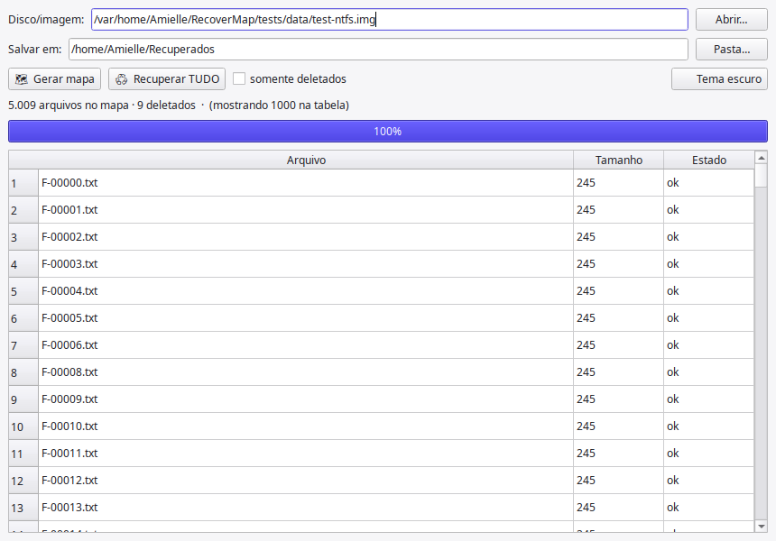
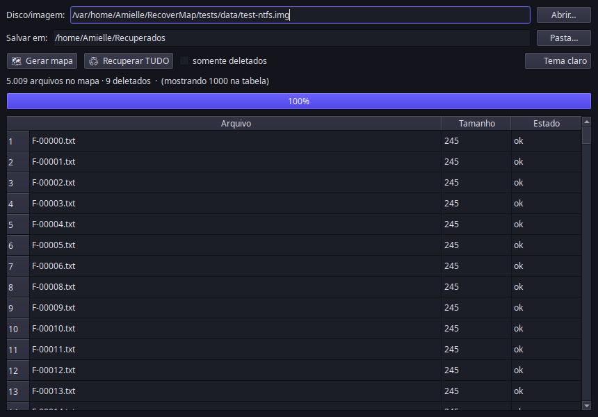

# RecoverMap ♻️

**Mapa completo do disco + recuperação de arquivos ILIMITADA** — open source, gratuito, para sempre.

Gera o inventário completo de um disco ou imagem (incluindo arquivos deletados), exporta o mapa em CSV/JSON/HTML e recupera **todos os arquivos de uma vez, sem limite de quantidade** — com um clique, em tema claro ou escuro.

> Feito para quem já conhece o fluxo "escanear → ver o mapa → recuperar": aqui o mapa é gerado pela própria ferramenta e a extração não tem trava de 4.000 arquivos por operação nem trava de painel. O engine é o **The Sleuth Kit**, o kit forense open-source padrão da indústria (usado pelo Autopsy) — **sem afiliação com o DMDE**.

## ⚠️ Segurança primeiro

- A fonte (disco/imagem) é aberta **somente-leitura** — o RecoverMap nunca escreve na mídia de origem.
- Antes de recuperar de um disco físico com problema, prefira cloná-lo primeiro (`ddrescue`, `dd`).
- Recupere sempre para **outro disco**, nunca para a própria origem.

## Download

- **Windows:** baixe `RecoverMap.exe` na página de [Releases](../../releases) (build automatizada; execute como administrativo para discos físicos `\\.\PhysicalDriveN`).
- **Linux/macOS:** `pipx install recovermap` ou `pip install .` no clone.

## Uso (GUI)

| Tema claro | Tema escuro (botão 🌙 no canto) |
|---|---|
|  |  |

1. Abra a imagem/disco → **Gerar mapa** → veja os arquivos (🗑 = deletado)
2. Escolha a pasta de destino → **Recuperar TUDO**
3. Botão **🌙 Tema escuro** no canto: alterna claro/escuro na hora

## Uso (CLI)

```bash
# inventário completo (mapa) em CSV/JSON/HTML — sem limite de entradas
recovermap map imagem.raw -o mapa.csv

# recuperar TUDO (alocados + deletados) numa única operação
recovermap recover imagem.raw -o pasta-salva/

# somente os arquivos deletados
recovermap recover imagem.raw -o recuperados/ --deleted-only

# partição em offset (ex.: início da partição 2)
recovermap recover imagem.raw -o out/ --offset 1048576
```

Relatório por arquivo (`recovermap-report.csv`): status, caminho original, SHA-256, tamanho e erros.

## Sistemas de arquivos

| Suportados (recuperação estruturada) | Não suportados (use carving) |
|---|---|
| NTFS, FAT12/16/32, exFAT, ext2/3/4, HFS+, UFS, ISO9660 | ReFS, Btrfs, APFS — nesses casos use [PhotoRec](https://www.cgsecurity.org/wiki/PhotoRec) (carving por assinatura, também livre) |

Limitações conhecidas: NTFS Alternate Data Streams (ADS) não são extraídos; nomes de arquivos deletados em FAT perdem o primeiro caractere.

## Licença

MIT (código do RecoverMap) + The Sleuth Kit/pytsk3 sob IPL-1.0/ASF — ver `LICENSE` e `NOTICE`.

## Desenvolvimento

```bash
python -m venv .venv && .venv/bin/pip install -e ".[gui,dev]"
.venv/bin/python -m recovermap.cli map tests/data/test-ntfs.img
```

Build local do executável: `pyinstaller --noconfirm recovermap.spec`
